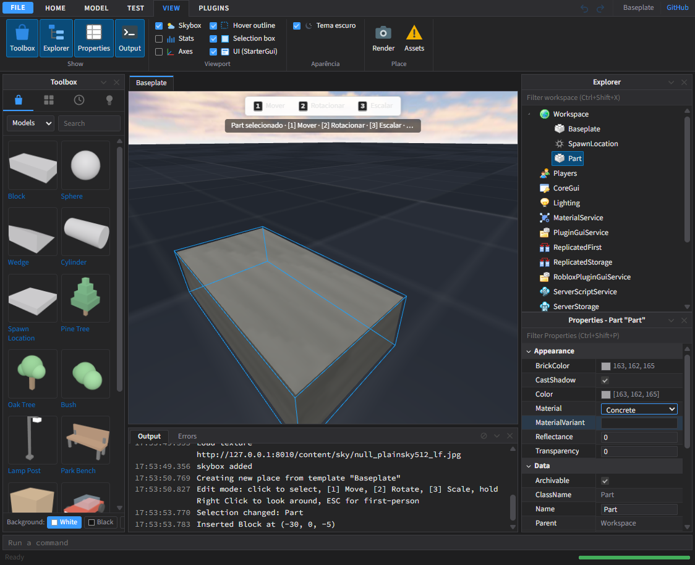
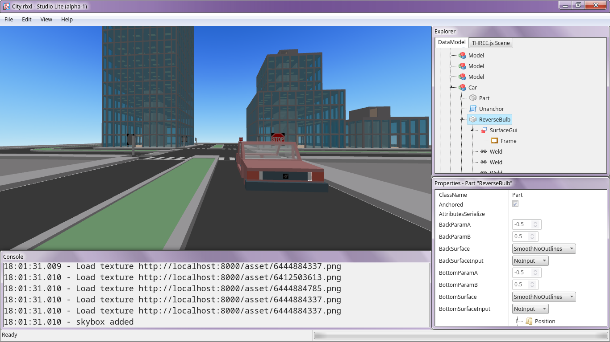
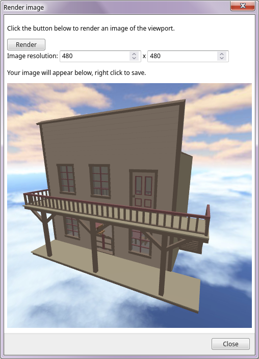
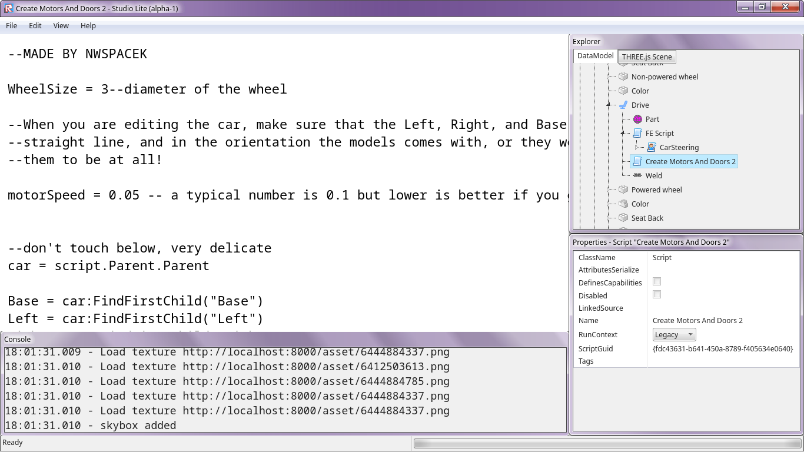

<!-- RobloxStudioLite — a browser-based Roblox Studio, reimagined. -->
<!-- Heads up: almost all of this was vibe-coded with Cursor. Details at the very bottom. -->

<div align="center">

# RobloxStudioLite

### A lightweight **Roblox Studio** that runs entirely in your browser.

Open, explore, **edit**, light, script and render `.rbxl` / `.rbxm` places — no installs, no account, just a tab.



<p>
  
  
  
  
  
</p>

</div>

---

## What is this?

RobloxStudioLite started life as a read-only web viewer and grew into a small, surprisingly capable **editor**. It loads real Roblox place and model files, renders them with [three.js](https://threejs.org/), and lets you build, light, animate and script scenes directly in the browser.

It is a fully **client-side** application. There is no bundler, no build step and no TypeScript — just native ES modules served over any static HTTP server. An optional Node service can proxy official Roblox asset APIs when you want to pull in decals and meshes.

> **Alpha software.** Expect rough edges and missing features. It is meant for tinkering, learning and quick renders — not production.

---

## Features

| Area | What you get |
| --- | --- |
| **Open files** | Read binary `.rbxl` / `.rbxm` places and models, browse the full DataModel in an Explorer + Properties panel. |
| **Edit mode** | Select, Move, Scale and Rotate with gizmos — bound to keys `1` `2` `3` `4`. Insert parts, folders and services. |
| **Lighting & shadows** | Add `PointLight`, `SpotLight` and `SurfaceLight` that cast real-time shadows, driven by `Lighting.Technology`. Tuned to stay smooth, not heavy. |
| **Materials** | A modern material set with procedurally generated, **seamlessly tiling** textures (brick, wood, grass, metal, ice, cobblestone and more) that repeat instead of stretching. |
| **GUI** | Build `ScreenGui`, `SurfaceGui` and `BillboardGui` trees and project text/textures onto part faces. |
| **Scripting** | An in-browser **Luau** runtime (WebAssembly) with a CodeMirror script editor. |
| **Play mode** | Spawn an **R6 / R15** avatar with idle, walk and jump animations and walk around your place. |
| **Animation editor** | A keyframe timeline (Moon-Animator style) plus a rig builder for quick dummies. |
| **Import 3D** | Bring in external `.fbx`, `.obj`, `.stl` and `.gltf/.glb` models via `File → Import 3D object`. |
| **Render** | Export the current view to a PNG at any resolution, with an optional transparent background for thumbnails. |
| **Dark theme** | A full dark UI for the whole studio, toggleable from the **View** tab. |

<div align="center">
  
  
  
</div>

---

## Quick start

RobloxStudioLite is 100% client-side, so any static web server works.

```bash
# 1. Clone
git clone https://github.com/bendimitri/RobloxStudioLite.git
cd RobloxStudioLite

# 2. Serve the folder (Python shown; Node, PHP, etc. all work)
python -m http.server 8000

# 3. Open it
#    http://localhost:8000
```

Pick a template on the Start Page (Baseplate, Crossroads, City, Suburban…) or open your own `.rbxl` / `.rbxm` file, and start building.

### Optional: asset server

Some Roblox assets (decals, meshes) need to be fetched through official APIs. The `server/` folder contains a small Node service for this.

```bash
cd server
cp .env.example .env     # configure your own credentials here
npm install
npm start
```

Any secrets, tokens or API keys live **only** on the server and are never shipped to the browser. No session cookies or `.ROBLOSECURITY` scraping is involved — only documented, official endpoints.

---

## Keyboard shortcuts

| Key | Tool |
| --- | --- |
| `1` | Select |
| `2` | Move |
| `3` | Scale |
| `4` | Rotate |
| `Right mouse (hold)` | Look around / fly camera |
| `Esc` | First-person / release |

---

## Tech stack

- **Vanilla JavaScript** (native ES modules, no bundler, no TypeScript)
- **[three.js](https://threejs.org/)** r176 for rendering, with FBX/OBJ/STL/GLTF loaders
- **Luau in WebAssembly** for in-browser scripting
- **[CodeMirror](https://codemirror.net/)** for the script editor
- **Node.js** for the optional asset proxy service

---

## Project structure

```
studio-lite/
├─ app/
│  ├─ rendering/      three.js renderer, materials, effects
│  ├─ controls/       transform gizmos, tools, cameras
│  ├─ datamodel/      Roblox class + property schema
│  ├─ gui/            ScreenGui / SurfaceGui / BillboardGui engine
│  ├─ scripting/      Luau runtime + editor
│  ├─ animation/      timeline, rig builder, animation editor
│  ├─ play/           play mode, avatar, controller
│  ├─ import/         FBX / OBJ / STL / GLTF importers
│  ├─ export/         rbxlx exporter
│  └─ ui/             ribbon, explorer, properties, toolbox, output
├─ server/            optional Node asset proxy
├─ examples/          sample places & models
└─ index.html
```

---

## Roadmap

- [ ] XML (`.rbxlx`) place support
- [ ] More primitive shapes (Truss and friends)
- [ ] ParticleEmitter, Fire & Smoke
- [ ] Neon glow
- [ ] Smooth Terrain rendering
- [ ] General bug fixing and polish

---

## License

Released under the **MIT License** — see [`LICENSE`](LICENSE).

The following are **excluded** from the MIT license as they belong to their respective owners:
`asset/`, `content/`, `examples/`, `favicon.ico`, and any bundled Roblox icons. Roblox Studio icons are copyright © Roblox Corporation.

**RobloxStudioLite is not affiliated with, or endorsed by, Roblox Corporation.** _Roblox_ is a registered trademark of Roblox Corporation.

---

<div align="center">

<sub>Built for fun, in the open.</sub>

</div>

<!--
  ──────────────────────────────────────────────────────────────
  Behind the curtain
  ──────────────────────────────────────────────────────────────
-->

<details>
<summary><sub>Credits & acknowledgements</sub></summary>

<br>

Standing on the shoulders of giants. This project builds on and takes inspiration from:

- **[Asicosilomu/studio-lite](https://github.com/Asicosilomu/studio-lite)** — the original Studio Lite viewer this project is based on.
- **[MoraineArchive/RobloxStudio-Datamining](https://github.com/MoraineArchive/RobloxStudio-Datamining)** — reference data for the Roblox class / property schema.
- **[Roboticela/animator](https://github.com/Roboticela/animator)** — reference for the keyframe animation editor.

Original foundations also rely on the [rbxBinaryParser](https://github.com/MrSprinkleToes/rbxBinaryParser) library by [MrSprinkleToes](https://github.com/MrSprinkleToes), plus [three.js](https://threejs.org/), [Luau](https://luau.org/) and [CodeMirror](https://codemirror.net/).

<br>

<sub><i>Psst — the bulk of this project was vibe-coded with <a href="https://cursor.com">Cursor</a>. Shh.</i></sub>

</details>
